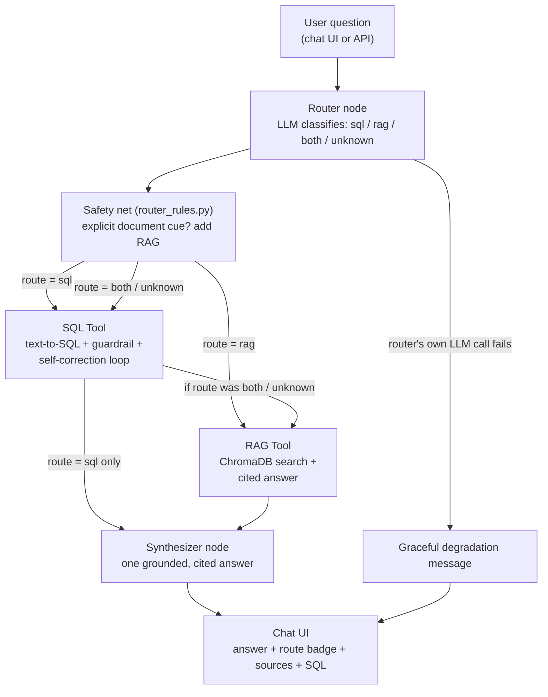

# Omni-Agent Analytics

**A Local-First Agentic System for Unified Querying Over Structured and Unstructured Enterprise Data with Self-Correcting SQL Generation**

CE452 — Minor Project · Final Year Project
Team: 23CE041 (Marshal Hirpara) · 23CE074 (Henil Movaliya) · 23CE079 (Deven Nirmal)

**Status: Phases 1–4 feature-complete and tested (99 automated tests). Remaining: Docker finalization and final report.**

---

## Table of Contents

1. [Overview](#overview)
2. [Architecture](#architecture)
3. [Technology Stack](#technology-stack)
4. [Project Structure](#project-structure)
5. [Setup & Installation](#setup--installation)
6. [Running & Using the System](#running--using-the-system)
7. [API Reference](#api-reference)
8. [Security Design](#security-design)
9. [Development Phases](#development-phases)
10. [Evaluation Results](#evaluation-results)
11. [Known Limitations](#known-limitations)
12. [Testing](#testing)
13. [Next Steps](#next-steps)

---

## Overview

Enterprises keep knowledge in two disconnected silos: structured records in relational databases, and unstructured knowledge in documents. Conventional RAG systems address only the documents, and most rely on cloud-hosted LLMs, which raises privacy and cost concerns.

**Omni-Agent Analytics** is a local-first, multi-agent hybrid RAG system that works as an autonomous data analyst. Given a natural-language question it:

1. **Routes** it to a SQL database, a document collection, or both (LangGraph state machine plus a rule-based safety net).
2. **Retrieves** the answer through a self-correcting text-to-SQL agent, or semantic search with citations.
3. **Recovers** from SQL errors (retry loop) and from LLM outages (graceful degradation).
4. **Synthesizes** one grounded, cited answer, showing the route taken, the sources used, and the exact SQL that ran.

After a one-time setup that downloads the models, everything runs **offline** on consumer hardware through a local model (Ollama, `llama3:8b`). No cloud API is called at runtime, including during evaluation.

### Key features

| Feature | What it does |
|---|---|
| Hybrid routing | LLM classifier plus deterministic safety net that guarantees document retrieval when a question explicitly refers to documents |
| Self-correcting SQL | Generates SQL, validates it, executes read-only, and feeds errors back to the LLM for up to 3 attempts |
| Cited answers | Route badge, source pills, and the generated SQL (with copy button) shown with every answer |
| **Live PDF upload** | Add a PDF (up to 10MB) in the chat UI; it is indexed immediately into the shared search index; removable from the UI |
| **Live database upload** | Upload a SQLite-dialect `.sql` script; it is validated by a dedicated guardrail, built into an isolated database, and becomes the active database; one-click reset to the demo database |
| Graceful degradation | An Ollama outage at any stage produces an honest message, never a crash or an invented cause |
| Measured reliability | Ablation study, Ragas evaluation with a local judge, latency breakdown, and router measurement with confidence intervals |

---

## Architecture



**Key design decisions**

- **The "both" branch runs sequentially** (SQL, then RAG), not in parallel, for reliability across LangGraph versions. The latency study quantifies the cost: about 62s versus about 40s (SQL only) and about 20s (RAG only).
- **Low confidence means query both.** If the router is unsure, both tools run and the synthesizer reconciles them, rather than guessing.
- **The safety net is mostly additive.** It adds document retrieval when a question explicitly names documents; it never changes `both`. The single exception: a question that names a document and contains no database vocabulary drops SQL, since there is nothing for SQL to answer.
- **Two separate guardrails.** Reading (questions) and building (database upload) have different needs, so each has its own validator. See [Security Design](#security-design).
- **Fully offline.** The UI loads no external fonts or scripts; embeddings, generation and evaluation all run locally.

---

## Technology Stack

| Layer | Choice | Notes |
|---|---|---|
| Orchestration | **LangGraph** | Router, tool nodes, synthesizer |
| Local inference | **Ollama (`llama3:8b`)** | Also the judge for Ragas evaluation |
| Vector DB | **ChromaDB** | Local embeddings: `all-MiniLM-L6-v2` (sentence-transformers) |
| Relational DB | **SQLite** | Chinook demo database; swappable at runtime |
| Backend | **FastAPI** | Serves the graph, uploads, and the UI |
| Frontend | **HTML / CSS / JS** | Single page; light and dark mode; no CDN dependencies |
| Evaluation | **Ragas** (local judge) | Faithfulness, answer relevancy, context precision |
| Testing | **pytest** | 99 tests |
| Packaging | **Docker** | Skeleton present; finalization in progress |

---

## Project Structure

```
omni-agent-analytics/
├── backend/
│   ├── app.py                  # FastAPI app: chat, uploads, database + document management
│   ├── graph.py                # LangGraph StateGraph: router, sql_tool, rag_tool, synthesizer
│   ├── router_sketch.py        # LLM route classifier (sql / rag / both / unknown)
│   ├── router_rules.py         # Deterministic safety net for the router
│   ├── llm_client.py           # Ollama HTTP client
│   └── static_index.html       # Chat UI (dark mode, drag-and-drop uploads, toasts)
├── data/
│   ├── db/                     # chinook.db (default); uploads/ holds the active uploaded DB (gitignored)
│   ├── pdfs/                   # Source PDFs; uploads/ holds live-uploaded PDFs (gitignored)
│   ├── samples/bookstore_demo.sql   # Ready-to-upload demo database script
│   └── chroma/                 # Persisted vector index (gitignored)
├── docker/                     # Dockerfile, docker-compose.yml (finalization in progress)
├── eval/
│   ├── golden_set_template.json     # 26-question golden evaluation set
│   ├── ablation_questions.json, run_ablation.py, ablationreport.py   # Self-correction ablation
│   ├── ragas_eval.py                # Ragas evaluation (local judge)
│   ├── latency_benchmark.py         # Per-stage latency study
│   ├── measure_router.py            # Router measurement (--holdout for the held-out set)
│   ├── router_eval_utils.py         # Validation + Wilson confidence intervals
│   ├── router_holdout.json          # Held-out router questions
│   └── *_results.* / *_report.md    # Generated results and reports
├── rag_pipeline/
│   ├── ingest.py               # PDF ingestion, chunking, single-file ingest
│   └── retrieve.py             # Embedding, indexing, retrieval, add/list/delete document
├── scripts/                    # generate_sample_pdfs.py, setup.py
├── sql_agent/
│   ├── agent.py                # Text-to-SQL with self-correction loop
│   ├── db_setup.py             # Read-only connection, swappable active DB, build-from-script
│   └── guardrails.py           # validate_select_only() and validate_schema_script()
├── tests/                      # test_guardrails, test_db_upload, test_router_rules,
│                               # test_graph_routing, test_router_eval_utils
├── requirements.txt
├── LICENSE
└── README.md
```

---

## Setup & Installation

### Prerequisites

- Python 3.12
- [Ollama](https://ollama.com) installed, with the model pulled: `ollama pull llama3:8b`

### Install

```bash
pip install -r requirements.txt
```

`requirements.txt` includes everything used by the app, the evaluation scripts and the tests (FastAPI, LangGraph, ChromaDB, sentence-transformers, pypdf, python-multipart, Ragas, pytest). For an exact snapshot of a working environment, `pip freeze > requirements.txt` is the authoritative source.

### First-time data setup

```bash
python scripts/setup.py
```

This builds `data/db/chinook.db` and the ChromaDB index from the PDFs in `data/pdfs/`. **It needs internet access once**, to download the ~80MB `all-MiniLM-L6-v2` embedding model (cached afterwards); pulling `llama3:8b` through Ollama also needs internet once. After that, the system runs fully offline.

> **Re-running setup resets the document index.** `scripts/setup.py` (and `python rag_pipeline/retrieve.py`) rebuild the index from `data/pdfs/` only. PDFs added through the UI are stored in `data/pdfs/uploads/`, which is not scanned, so they drop out of the index (the files stay on disk) and need to be uploaded again.

---

## Running & Using the System

1. Start Ollama if it is not already running: `ollama serve`
2. From the **project root** (imports depend on it):
   ```bash
   uvicorn backend.app:app --reload --port 8000
   ```
3. Open **http://localhost:8000/**

### Asking questions

Type a question. The UI shows a route badge (SQL / Documents / Hybrid), source pills, and the generated SQL where relevant. If the rule-based safety net changed the LLM's route, the badge is underlined and a hover tooltip says why.

### Adding a PDF live

Open **Indexed documents**, then drag a PDF onto the dropzone (or click to choose). Limit 10MB. The file is indexed into the shared index immediately and cited in future answers. Each document has a **Remove** button.

### Connecting your own database

Open **Database**, then drag in a `.sql` script. It must be SQLite-dialect SQL using only `CREATE TABLE`, `CREATE INDEX` and `INSERT`. On success the badge turns amber, the tables are listed, and a divider marks the change in the chat. **Reset to demo database** restores Chinook.

A ready-made script is included: `data/samples/bookstore_demo.sql` (5 tables: authors, books, customers, orders, order_items). Try:
- "Which author has written the most books?" (Haruki Murakami, 3 books)
- "How many orders are still processing?" (3)

> Windows note: use `curl.exe` (not `curl`) in PowerShell when testing endpoints manually, because PowerShell aliases `curl` to a different command.

---

## API Reference

| Method | Endpoint | Purpose |
|---|---|---|
| GET | `/health` | Liveness check (drives the UI status dot) |
| POST | `/chat` | Unified question endpoint: route, execute, synthesize |
| POST | `/documents/upload` | Upload a PDF (max 10MB) into the shared index |
| GET | `/documents` | List indexed documents |
| DELETE | `/documents/{doc_id}` | Remove a document and its chunks |
| GET | `/database/status` | Active database, its tables, whether it is the default |
| POST | `/database/upload` | Upload a `.sql` script, build it, make it the active database |
| POST | `/database/reset` | Revert to the Chinook demo database |
| POST | `/sql/ask`, `/rag/ask` | Debug endpoints that call one pipeline directly, bypassing the router |
| GET | `/llm/benchmark` | Baseline Ollama latency |

---

## Security Design

The system executes SQL written by an LLM and, since live uploads, also accepts files from users. Defense in depth:

| Layer | Question answering | Database upload |
|---|---|---|
| Guardrail | `validate_select_only()`: single SELECT statement only, forbidden keywords blocked, comments stripped, row limit enforced (200) | `validate_schema_script()`: allowlist of `CREATE TABLE`, `CREATE INDEX`, `INSERT` only |
| What is blocked | Any write or DDL, stacked statements | `ATTACH`, `PRAGMA`, `DROP`, `ALTER`, `DELETE`, `UPDATE`, triggers, views, and any `SELECT`/`WITH` in code (closes `CREATE TABLE … AS SELECT` / `INSERT … SELECT` tricks such as `pragma_*()` functions) |
| Execution | Read-only SQLite connection (`mode=ro`) | Built into a brand-new isolated file, never the live database; 20-second time limit; 5,000-statement cap; `PRAGMA integrity_check` before activation |
| Data handling | n/a | Quote-aware parsing: text values containing `;`, `--`, or words like "select" or "drop" are treated as data, not syntax |
| File handling | n/a | 10MB cap enforced on bytes read, UTF-8 text only, binary rejected |

**PDF uploads:** size cap enforced on bytes read, `%PDF-` magic bytes checked (not just the extension), files stored under random names (the user's filename is never used as a path), and image-only PDFs with no extractable text are rejected.

---

## Development Phases

### Phase 1 — Foundations
Isolated pipelines, tested separately: a text-to-SQL agent with self-correction and guardrails over the Chinook database, and a document pipeline (3 PDFs, semantic chunking, local embeddings in ChromaDB, cited answers), plus Ollama, a FastAPI scaffold and a Docker skeleton.

### Phase 2 — Integration
A single LangGraph graph (router, tool nodes, synthesizer) with the low-confidence "query both" fallback; relevance-filtered retrieval (a distance threshold so irrelevant chunks are no longer cited); a unified `/chat` endpoint; and the chat UI.

### Phase 3 — Hardening & Evaluation
Guardrail adversarial tests and graceful degradation (verified against a real Ollama outage); the self-correction ablation; a 26-question golden set; Ragas evaluation with a local judge; and a per-stage latency breakdown. Evaluation found two real issues: LLM router misclassification and synthesizer over-hedging when one source was irrelevant. The latter was fixed.

### Phase 4 — Live uploads, UI and router hardening
- **Live PDF upload** with incremental indexing (existing documents are untouched), listing and removal.
- **Live database upload** with its own guardrail, isolated build, execution timeout, integrity check, one-at-a-time active database and reset. The agent and graph needed no changes, because they reach the database only through `db_setup.py`.
- **UI redesign:** dark mode (persisted), drag-and-drop uploads, toast notifications, animated thinking indicator, live backend-status dot, copy-SQL button, route-badge tooltip. The UI needs no internet access.
- **Router safety net** (`backend/router_rules.py`): see below.

---

## Evaluation Results

### Self-correction ablation (16 SQL questions)

| Condition | Success |
|---|---|
| Without self-correction (1 attempt) | 15/16 (93.8%) |
| With self-correction (up to 3 attempts) | **16/16 (100%)** |

One question ("show total sales for each year, ordered by year") failed on the first attempt and succeeded on the second after the LLM corrected its date-grouping SQL.

### Ragas (local `llama3:8b` judge; 19 sql / doc / hybrid golden questions)

| Metric | Score |
|---|---|
| Faithfulness | 0.855 |
| Answer relevancy | 0.610 |
| Context precision (no reference) | 0.763 |

Ambiguous-question routing: 3/3 acceptable. Adversarial questions (including a natural-language "update every customer's email…"): 4/4 confirmed safe end to end.

### Latency (golden set, one run each)

| Stage | Mean | Share |
|---|---|---|
| Router | 4.0s | 8.6% |
| SQL tool | 21.2s | 45.1% (largest) |
| RAG tool | 10.3s | 22.0% |
| Synthesizer | 18.7s | 39.7% |
| **Total** | **47.0s** | |

By route: RAG-only 20.3s · SQL-only 40.1s · both 61.7s.

### Router measurement

"Source coverage" means every tool the question needs actually runs. All intervals are 95% Wilson confidence intervals.

**In-sample (golden set, 19 questions).** The safety net's cue words were chosen after seeing failures on this set, so this shows the known failures are fixed. It is **not** a generalization estimate.

| | LLM only | + safety net |
|---|---|---|
| Source coverage | 68.4% (13/19; CI 46–85%) | 94.7% (18/19; CI 75–99%) |
| Over-routed (an extra tool runs) | 31.6% | 47.4% |

**Held-out (12 questions written without access to the routing rules; `python eval/measure_router.py --holdout`)**

| | LLM only | + safety net |
|---|---|---|
| Source coverage | 75% (9/12; CI 47–91%) | 83.3% (10/12; CI 55–95%) |
| Hybrid questions covered | 0/4 | 4/4 |
| Over-routed | 2/12 | 2/12 |

On the held-out set the net recovered four hybrid questions the LLM had sent to SQL only, and no question got worse. With n=12 the intervals overlap and the improvement is encouraging rather than statistically conclusive. The recovered questions all contained explicit cue words; the net is untested on cue-free phrasing.

Reproduce: `python eval/measure_router.py` (golden set) and `python eval/measure_router.py --holdout`.

---

## Known Limitations

1. **Router.** The LLM classifier is imperfect. The safety net only recognises explicit document cues, so document questions phrased without cue words depend on the LLM alone. In-sample, one SQL question ("How many distinct genres are there in the catalog?") was routed to documents only because of the word "catalog"; the net cannot see this opposite failure.
2. **Sequential "both" route.** Chosen for reliability; costs about 62s versus about 40s or 20s for single-source routes. The safety net can also add a tool a question does not need (over-routing), trading speed for correctness.
3. **One shared active database.** The active database is global state. That is fine for a single-user demo, but a database swapped mid-question could give that one request a mismatched schema.
4. **Evaluation covers Chinook only.** The ablation, Ragas, latency and routing figures were measured on the Chinook demo database and the three bundled PDFs. They do not transfer to uploaded databases or documents.
5. **Uploaded content.** Re-running the setup script resets the document index and drops live-uploaded PDFs from it (see Setup). The database upload accepts only SQLite-dialect SQL (MySQL/PostgreSQL dumps usually fail), and triggers and views are deliberately unsupported. Uploaded PDFs must contain extractable text. A PDF's text becomes LLM context, so a crafted document could attempt prompt injection; full defense is out of scope and is documented here instead.
6. **Golden set.** 26 questions (scoped down from the original plan of 50–60). Some SQL reference answers were authored as reference queries and may still need their numeric values filled in.
7. **Document/schema mismatch.** The policy documents mention an audiobook genre exception; whether that genre exists in the Chinook `Genre` table has not been confirmed.
8. **Environment.** Ollama on one development machine occasionally crashed with a CUDA driver error (`shared object initialization failed`); it recovered on retry. Graceful degradation means the app no longer crashes when this happens.

---

## Testing

```bash
pytest tests/ -v          # 99 tests
```

| File | Covers |
|---|---|
| `test_guardrails.py` | SELECT-only guardrail, adversarial queries, behaviour when Ollama is unreachable |
| `test_db_upload.py` | Schema-script guardrail, quote-aware parsing, build/swap/reset lifecycle, timeout, bundled sample |
| `test_router_rules.py` | Safety-net rules, false-positive protections, golden-set regression |
| `test_graph_routing.py` | The real LangGraph graph with fake tools: which tools actually run |
| `test_router_eval_utils.py` | Held-out file validation and confidence-interval maths |

Evaluation scripts (need Ollama running):

```bash
python eval/run_ablation.py && python eval/ablationreport.py     # ablation
python eval/ragas_eval.py                                        # Ragas
python eval/latency_benchmark.py                                 # latency
python eval/measure_router.py [--holdout]                        # router
```

---

## Next Steps

- Finalize Docker packaging for reproducible deployment
- Demo rehearsal on the presentation hardware
- Final report: architecture, methodology, evaluation results and the documented limitations above